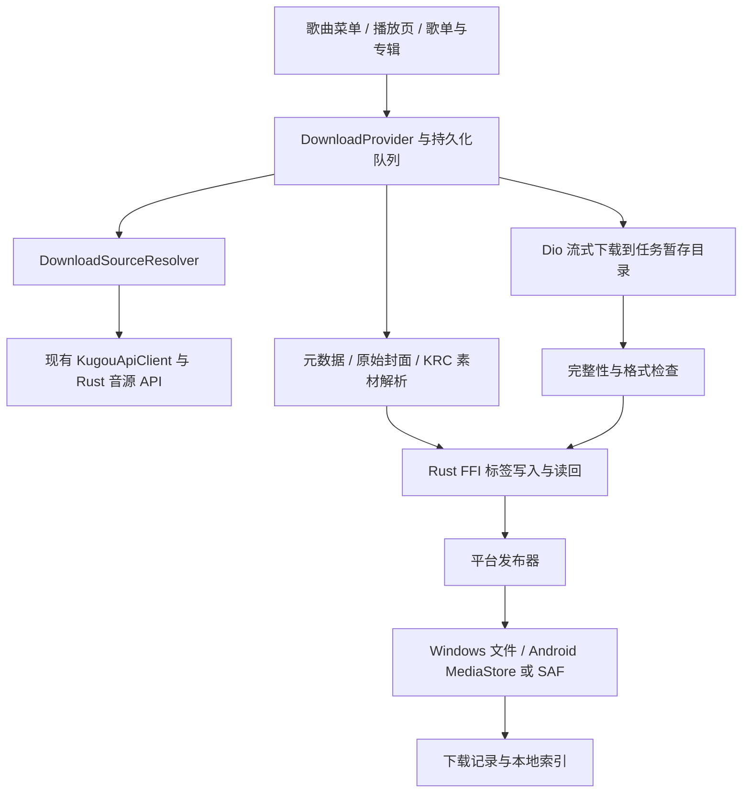

# MD3Music 下载、批量下载与 Rust 音频标签写入计划

调研日期：2026-11-07。任务仓库：`D:\Documents\KgMobile\md3Music`。
本轮更新：用户已授权实施，且最终只构建 Android 安装包；文件命名固定为 `歌手-歌名`。按用户补充要求，将最高可用清晰度封面、歌手、歌名、专辑、曲序、日期、流派、词曲作者及逐字歌词设为默认写入目标，逐字歌词优先兼容 ESLyric；接口以 `MakcRe/KuGouMusicApi` 的文档和实现为参考。
克隆来源：`https://github.com/BonBonifacy/md3Music.git`，分支 `rust-local-force`，基线提交 `3fee5ad595fa31228dbae0c0764f5681cf220e82`，应用声明版本 `6.3.0+54`。
用户已授权开始实施。歌曲命名固定为 `歌手-歌名.扩展名`，不在连字符两侧添加空格；非法文件名字符替换为下划线，同名文件保留原文件并加任务后缀。克隆后工作区原本干净；未发现仓库内的 `AGENTS.md`，本计划遵循用户提供的工程规划规范。

## 🎯 Project Overview & Scope

### 目标与验收标准

为 Android、Windows 用户补齐在线歌曲的单曲下载、歌单/专辑批量下载和下载文件的音频元数据写入。这里的“标签”指文件内的歌曲信息、封面和歌词等元数据，不是歌单分类标签或 Git tag。

| 编号 | 输入与触发 | 可观察的验收结果 |
| --- | --- | --- |
| AC-01 | 在在线歌曲菜单或两种播放页点击下载并选择音质 | 生成一个完整、可播放的本地文件；显示请求音质和实际音质；试听、权限不足或响应异常不会计为完整下载成功。 |
| AC-02 | 在歌单/专辑选择若干首或“全部下载” | 选中集合准确入队；全部下载覆盖完整分页结果；重复项去重；逐项展示成功、跳过、失败及原因，单项失败不终止整批。 |
| AC-03 | 下载中暂停、取消、断网、重试或重启应用 | 已提交任务可恢复；支持安全续传，不能续传时重新下载；取消后迟到回调不能发布文件；重启后显示中断状态并允许继续。 |
| AC-04 | 选择默认目标或用户授权目录 | Windows 保存到可见目录；Android 按平台支持发布到共享音乐库或 SAF 授权目录；失败时不留下被误认为完成的文件，不覆盖用户已有文件。 |
| AC-05 | 启用写标签并提交字段 | Rust 只接受本计划定义的字段、类型和限制；未知键拒绝；除固定 comment 清理外，缺失值不清空原标签；能报告已写入、格式不支持及失败字段。 |
| AC-06 | 下载实际为 MP3 或 FLAC 的音频 | 写入指定标签、最高可用清晰度封面和优先兼容 ESLyric 的逐字歌词后可独立读回；音频仍可播放。标签失败保留已验证的原始音频，显示“音频已下载，标签未完成”，不得计为完整交付。 |
| AC-07 | 下载完成后打开下载管理或本地曲库 | 可直接离线播放；本地索引按最终路径/URI 更新；半成品不进入曲库，媒体扫描权限被拒绝也不妨碍播放本应用刚下载的文件。 |
| AC-08 | 使用现有搜索、播放、歌词、云盘上传与本地音乐功能 | 旧 API、FFI 启停符号、播放试听策略和原有菜单行为保持兼容；Android/Windows 包含匹配的新 Rust 库。 |
| AC-09 | 批量提交 1,000 首并同时播放音乐 | 网络传输不整曲读入内存；默认最多 3 个音频下载、1 个标签写入；进度通知合并到每秒最多 4 次，任务变化立即通知；记录内存及播放影响。此项是拟议验证目标，当前没有性能基线。 |
| AC-10 | 同一发行版本存在原图、多个尺寸封面和 UI 缩略图 | 在同版本专辑封面候选中，写入经实际尺寸验证的最高可用清晰度图片；保留原始分辨率及 JPEG/PNG 字节，不主动缩图、重压缩或放大。记录尺寸与选择依据；受资源或容器限制时明确报告未完成，不静默换成低清封面。 |
| AC-11 | 对一首歌获取完整元数据后下载 | 写入歌手、歌名、专辑、真实专辑曲序/碟号、发行日期、流派、作词者和作曲者；各字段关联来源及版本身份。缺失字段报告不可获取或失败，不用歌单顺序、歌手名或下载日期填充。 |
| AC-12 | 源歌词含真实逐字起止时间 | 将时间轴按 ESLyric 兼容增强 LRC 配置写入音频，保留逐字时间和末字结束，不转成仅有行时间或纯文本。移走 sidecar、断网并脱离应用数据库后，foobar2000 + ESLyric 仍能从 MP3/FLAC 标签逐字显示；无逐字源时才允许有标识地降级。 |

### 范围与非目标

- 首版范围：普通在线歌曲；单曲、歌单多选、歌单/专辑全部下载；下载管理、取消/暂停/继续/重试、持久化、目标目录、文件名；默认完整写入用户指定的标签、最高可用清晰度封面及逐字歌词，ESLyric 兼容优先；Android 与 Windows。
- 保持兼容：现有 MD3/AM 播放页、TV 遥控菜单、Windows 右键菜单、现有音质代号及账号认证机制。TV 复用可聚焦的下载入口和管理页，不另造一套队列。
- 首版不纳入云盘、NAS、听书、MV、伴奏或分轨下载；这些来源具有不同鉴权/格式契约。来源不支持时明确说明原因，原有播放和云盘上传继续可用。
- 不在首版编辑任意已有本地文件；保留 Lyrico 外部编辑入口。Rust 写入仅作用于本应用下载任务的暂存副本。
- 首版保证应用进程存活时队列运行及重启恢复；Android 系统杀进程后的持续后台传输，需要独立的原生后台任务方案，暂不承诺。切换页面不应中断队列。
- 不新增通用音频 HTTP 代理，不将 NAS 临时缓存作为永久下载目录，不做转码。

### 当前实现与推荐设计

#### 克隆基线的项目结构与功能（新增行为见实施记录）

| 位置 / 符号 | 当前职责与证据 |
| --- | --- |
| `README.md`、`pubspec.yaml` | Material 3 Flutter 音乐客户端；覆盖在线搜索、推荐、歌单、专辑、歌手、歌词、评论、私人 FM、本地音乐、云盘、NAS、投屏、账号、TV 和 Windows。声明版本 `6.3.0+54`，Dart 约束 `^3.12.0`。 |
| `lib/main.dart` → `lib/app.dart` | 启动平台服务和 Rust 本地 API；`MultiProvider` 组装应用级状态，已有 `LibraryProvider`、`CloudUploadProvider`、`KugouProvider` 等。 |
| `lib/modules/`、`lib/widgets/` | 页面和共用组件；单曲菜单位于 `SongListItem._showMoreMenu`，MD3/AM 播放页分别有 `_showMoreMenu`。 |
| `lib/providers/player_provider.dart` | 播放、队列、音源解析、歌词与平台输出协调；应避免让下载任务改动当前播放的音源或音质。 |
| `lib/services/kugou_api/kugou_api_client.dart`、`kugou_models.dart` | `getSongUrl`、`getSongUrlWithFallback` 解析完整音源/试听和真实音质；`KugouPlayUrl` 包含 URL、文件大小、码率、音质与 `isTrial`。`getSongsDetails` 可批量补全详情。 |
| `lib/services/kugou_server.dart` → `kugou_api_server/rust/src/lib.rs` → `server.rs` → `modules/` | Flutter 通过 FFI 启动本机回环 HTTP 服务；Android 有 MethodChannel/JNI 启停回退；Rust 模块代理酷狗 API。属于嵌入式库，不是独立远程后端。 |
| `kugou_api_server/rust/src/modules/song_url.rs`、`song_url_new.rs` | 请求上游音源并回填真实音质；`server.rs` 明确将 `/audio/proxy` 返回 403，要求直接使用 CDN。 |
| `lib/modules/playlist/playlist_songs_loader.dart` | `PlaylistSongsLoader.fetch` 复用 listid/global_collection_id/专辑加载和收藏缓存；有 `isComplete`，但部分回退分支及上限截断尚未完整表达完整性。 |
| `lib/modules/playlist/playlist_page.dart` | 已有多选、全选及 `extraMultiSelectActions` 扩展点。`SongListItem.extraMenuTilesBuilder` 可扩展单曲菜单。专辑详情在 `lib/modules/album/album_detail_page.dart`。 |
| `lib/providers/cloud_upload_provider.dart` | 可参考应用级队列、进度和页面解耦方式；现有上传任务只在内存中且严格串行，不能直接承担可恢复下载。 |
| `lib/core/services/remote/remote_download_cache.dart` | NAS/FTP 临时缓存，具有 `.part` 和 LRU 淘汰；适合参考半成品隔离，不适合直接保存永久音乐。 |
| `lib/data/repositories/local_music_repository.dart`、`lib/providers/library_provider.dart` | MediaStore/文件/SAF 扫描、缓存及分类；`LibraryProvider.loadLocalMusic` 会请求媒体读取授权，不应对每首下载都重新全盘扫描。 |
| `lib/core/utils/local_lyric_loader.dart`、`audio_scanner.dart` | 已能读本地封面及多种内嵌歌词；可用于独立读回验证。 |
| `lib/services/kugou_api/kugou_models.dart::_resolveArtworkUri` | 当前将 `{size}` 替换为 `400`，属于 UI 展示尺寸，不能把这里生成的 `artworkUri` 直接视为最高分辨率封面。 |
| `lib/services/kugou_api/kugou_api_client.dart::getKrmAudio`、`getImages` | 当前 `getKrmAudio(String hash)` 发送 hash，但 Rust `/krm/audio` 实际读取 `album_audio_id`；下载需新增正确的强类型入口。现有 `getImages` 仅暴露 hash，尚未暴露 album_id、album_audio_id、count。 |
| `lib/widgets/apple_lyrics/parsers/krc_parser.dart`、`lib/widgets/apple_lyrics/parsers/lrc_parser.dart`、`lib/widgets/apple_lyrics/models/lyric_line.dart` | `KrcParser.parse` 可生成具有绝对起始时间及 duration 的 `LyricWord`；LRC 解析器支持尖括号增强时间戳。已有词级模型可复用，不必重新发明时间轴。 |
| `lib/core/services/lyric_info_json_builder.dart::buildRawLyricLane` | 已能输出行首方括号、字首尖括号和可选末字结束时间；可复用格式化基础，但现有输出未承诺保留每个词间静音和完整词结束时间，需要下载专用验证。 |
| `lib/core/utils/local_lyric_loader.dart::_maxEmbeddedReadBytes` | 当前 MP3 通用读取对整个文件超过 16 MiB 直接跳过，FLAC 仅缓冲前 16 MiB；大音频或大封面可能使内嵌歌词读不到。必须修正目标读取路径，不能只提高全文件读取上限。 |
| `lib/core/services/lyrico_editor.dart` | “编辑信息”通过外部 Lyrico 修改文件；当前 Rust 路由、导出符号和依赖中没有音频标签写入能力，也没有现成的允许写入字段清单。 |
| `lib/core/services/folder_picker_service.dart`、`android/app/src/main/kotlin/com/md3music/md3music/MainActivity.kt` | Windows 使用 `file_selector`；Android SAF 目录选择当前仅持久化读取权限，不能据此认定允许写入。 |
| `third_party/`、`android/`、`windows/` | 本地 Flutter 插件 fork 和原生平台桥接；下载功能需服从现有播放器和原生库打包约定。 |
| `.github/workflows/stability-checks.yml`、`test/`、`kugou_api_server/rust/tests/` | 存在真实 Flutter、Rust 和 Android JVM 检查入口；不是空项目。 |

实际播放调用链为：页面 → Provider → `KugouApiClient` → 回环 Rust 路由 → 上游 API → CDN URL → 播放器。克隆基线树内没有用户可用的音乐下载管理模块，当前实现已新增该模块。`.import.fastimport` 的历史提交描述虽提过下载，不代表当前导出树含有这些实现，不以历史描述作为可复用代码的依据。

#### 推荐的职责划分

- Flutter 负责来源解析、网络传输、队列和界面；Rust 负责受限文件标签写入。沿用 Dio 与原生库，不新增另一套 Rust 下载线程/HTTP 控制接口。
- 标签写入使用新增 C FFI，放入 worker isolate，避免把本地文件写入能力开放给现有宽松 CORS 的 HTTP 服务。isolate 仅隔离耗时工作，不隔离 Rust 进程崩溃。
- 所有音频先进入应用私有、持久化暂存目录 `getApplicationSupportDirectory()/download_staging`，经校验和写标签后，再发布到用户目标。`content://` 不转成猜测的文件路径，也不直接交给 `std::fs`。
- Android API 29+ 默认发布到 `MediaStore.Audio` 的 `Music/MD3Music`；老系统使用用户选择的 SAF 可写目录。Windows 默认 `getApplicationDocumentsDirectory()/MD3Music/Downloads`，支持用户选目录。
- Android 写共享媒体使用 pending 行，在完整复制后发布；SAF 提供者不一定支持原子重命名，要显式处理暂存文档和失败清理。依据：[Android 共享媒体写入](https://developer.android.com/training/data-storage/shared/media)。私有暂存与已发布音乐分开，避免用户卸载后丢失已导出的音乐，参见[应用专属文件生命周期](https://developer.android.com/training/data-storage/app-specific)。

#### 队列、音源与数据契约（实施后的实际结构）

| 对象 | 契约 |
| --- | --- |
| `DownloadOptions` | `quality`、`allowFallback`、`destination`；默认 flac、允许明确展示的降级；所有用户指定标签默认启用，不提供关闭必需标签的开关。 |
| `DownloadMetadataBundle` | 实际为 `DownloadMetadata`，位于 `lib/core/services/download/download_metadata_resolver.dart`，含 fields、coverUrls、provenance；规范化歌词写入任务 tags，原始 KRC 存 `.krc`。 |
| `DownloadSource` | 实际为仅运行时使用的 Map，含 URL、实际音质及预期字节数；`DownloadTask` 保存 expectedBytes/sourceDigest；不持久化签名 URL、token 或 cookie。 |
| `DownloadSourceResolver.resolve` | 实际为 `resolveDownloadSource` 和 `KugouApiClient.resolveSongDownloadUrl`；45 秒解析边界，不申请 free_part；核对权限、试听及实际音质，继续探测静默降级后的更好音源。 |
| `downloads.db` | 独立 version 1 SQLite，`download_tasks(id PRIMARY KEY, dedup UNIQUE, payload JSON)`；批次 ID、选曲快照、账号、状态、进度、输出、字段来源、缺失项和 tags 在任务行中保存。一次事务入队，不修改听歌统计库。 |
| 去重与事务 | 同账号 hash+albumAudioId+请求音质+目标组成去重键；重复入队跳过已有记录。当前完成记录也保留去重键，重新下载已删除成品时需先移除记录；这是首版明确限制。 |
| 任务状态 | queued → resolving → downloading → verifying → tagging → publishing → completed，另有 paused/failed/cancelled；fullyComplete 由 completed、missing 为空且 error 为空共同决定，不把音频完成视为标签齐全。 |
| 崩溃恢复 | 重启将运行中/排队任务恢复为 paused；Windows 发布意图记录目标和摘要，Android 持久化 pending/complete URI，重试核对摘要后接管。SAF 重命名与偏好提交间仍存在非原子窗口，须实机验收。 |
| 批量快照 | 选中项按当前显示顺序固化；“全部下载”先获得完整分页结果再入队。达到分页/数量保护上限或中途失败要返回不完整状态，提供重试或显式“仅下载已获取 N 首”，不能悄悄称为全部。 |
| 错误 | Dio 错误只保存类型及状态码，避免落盘签名 URL；源/格式/权限/标签/发布错误均显示可操作原因，缺失字段单独列出；不承诺逐错误码的公共稳定枚举。 |

现有 `KugouPlayUrl.isTrial` 含“小于 200KB”的启发式判断，不能将这一阈值作为下载拒绝短曲的唯一依据。下载解析要保留原始的权限/试听标记；上游缺少可靠标记时，用容器、返回时长及下载后音频信息交叉验证，仍无法确认完整性的结果返回明确原因。不能假设播放接口也存在独立下载授权字段；若实际响应有该字段，纳入验证后再使用。

续传要求服务端返回正确的 `206` 和 `Content-Range`，并核对 ETag/Last-Modified 或可靠的资源身份。返回 `200` 时从头写入；`416` 先验证是否已完整；重新解析过期 URL 后不能直接拼接旧数据。CDN 不支持可靠续传时允许安全重下。取消先递增任务代次并关闭流，迟到的解析、标签或发布结果不得覆盖新状态。发布器须串行化“接受取消”和最终提交：提交前接受取消就撤销暂存输出；若已完成最终重命名或媒体发布，则返回已完成，取消操作不再删除成品。

#### 参考 API、字段来源与现有适配差异

参考仓库为 [MakcRe/KuGouMusicApi](https://github.com/MakcRe/KuGouMusicApi)，本轮核对了其 `main` 文档与以下模块；实施时记录实际参考提交。参考用于对齐嵌入式 Rust API 契约，不新增 Node.js 服务或将账号请求改发外部公共实例。

| 目标 | 参考接口与参数 | 项目内接入及证据 |
| --- | --- | --- |
| 歌名、歌手、发行身份 | `/audio?hash=...`；`/krm/audio?album_audio_id=...&fields=album_info,base,authors.base,audio_info,extra,tags,tagmap` | 参考 [audio.js](https://github.com/MakcRe/KuGouMusicApi/blob/main/module/audio.js)、[krm_audio.js](https://github.com/MakcRe/KuGouMusicApi/blob/main/module/krm_audio.js)。现有 `getSongsDetails` 及 Rust `audio_more::handle_krm_audio` 可复用；新增按 albumAudioId 查询的方法，保留旧 `getKrmAudio` 调用签名以兼容。 |
| 日期、专辑、原始封面 | `/album/detail?id=...`，参考实现明确请求 `publish_date/sizable_cover/authors` 等字段 | 参考 [album_detail.js](https://github.com/MakcRe/KuGouMusicApi/blob/main/module/album_detail.js)。Rust 已兼容 id/album_id；下载适配器保留原始 `sizable_cover`，不先经过 UI 解析的 400px 替换。 |
| 真实曲序、碟号 | `/album/songs?id=...&page=...&pagesize=...`，与目标 album_audio_id 对应 | 参考 [album_songs.js](https://github.com/MakcRe/KuGouMusicApi/blob/main/module/album_songs.js)。完整分页并核对发行版本；真实曲号/碟号的响应字段需要样本确认，不能用返回数组下标或 playlistSort 冒充。 |
| 最高可用专辑封面候选 | `/images?hash=...&album_id=...&album_audio_id=...&count=...` | 参考 [images.js](https://github.com/MakcRe/KuGouMusicApi/blob/main/module/images.js)。Rust `images::handle_images` 已支持这些参数；扩展 Dart 下载专用入口。区分专辑正面封面与歌手照片，`/images/audio` 不作为替代专辑封面的默认来源。 |
| 逐字歌词来源 | `/search/lyric?hash=...&album_audio_id=...&man=yes`，以候选 id/accesskey 请求 `/lyric?id=...&accesskey=...&fmt=krc&decode=true` | 参考 [search_lyric.js](https://github.com/MakcRe/KuGouMusicApi/blob/main/module/search_lyric.js)、[lyric.js](https://github.com/MakcRe/KuGouMusicApi/blob/main/module/lyric.js)。现有 `getLyricResult` 和 Rust 路由可复用，但下载必须等 KRC 最终结果，不把先返回的 LRC 当作逐字素材完成；fmt 必须显式传入，避免参考 JS 与本地 Rust 的默认值差异。 |

流派与词曲角色先从 `/krm/audio` 的结构化扩展信息采集；接口公开了 fields 选择器，不代表承诺返回某个固定的 genre/composer/lyricist 路径。S13 以真实响应样本记录字段与角色含义；必要时只从明确署名的歌词头/署名行提取“作词/作曲”，不把“演唱/制作人/编曲”误写为词曲作者。搜索分类/情绪标签不自动当流派。日期取目标发行版本的 `publish_date`，纯日期不做 UTC 换日。

已新增 `getDownloadMetadataByAlbumAudioId(albumAudioId)`，并为图片查询提供可选 albumId/albumAudioId/count 参数，旧签名保留兼容适配。原始签名图片 URL 和歌词 accesskey 仅用于当前内存请求；数据库/探测记录只保存资源标识、脱敏来源、尺寸和摘要，不因素材富化引入凭据持久化。

#### 最高可用清晰度封面策略

1. 收集匹配同一 `albumId/albumAudioId` 的原始 URL/尺寸模板和接口候选；候选缓存以资源身份及原始 URL/尺寸区分，不复用缩略图缓存文件。
2. 优先接口明确返回的原始图片；对于 `{size}`，仅使用该域名/路径已验证的原图或有效尺寸规则。`0` 是否代表原图、最大档位是多少，当前参考模块没有保证，须由 S14 实测，不能把任意尺寸替换称为拿到了原图。
3. 从响应真实图片头读取 width/height/MIME，比较同一封面内容候选的像素尺寸；URL 写 4000 而实际返回 400 的不能算高清。遇到 404 或失效候选可选择其它经验证的最高可用图，记录探测结果。
4. JPEG/PNG 以原始压缩字节写入 FrontCover，读回后摘要一致；不裁切、不缩图、不 JPEG 重编码、不用低清图放大。只有最高原图编码不兼容时，才验证同尺寸无损 PNG 转换，并记录转换及体积；无法无损处理则报告封面未完成。
5. 应用防资源耗尽上限拟提高到 64 MiB 编码字节及 1 亿像素，图片头检查不进行全图解码；这是资源边界，不是降清晰度策略。还须服从容器本身上限，例如 FLAC 的单 metadata block 长度只有 24 位，PICTURE 的图片与结构总长不得超限，参见 [RFC 9639 §8.1](https://www.rfc-editor.org/rfc/rfc9639.html#section-8.1)。超限保留原图素材并报告，不能静默压缩或改用 400px。

“最高”指匹配该发行版本、通过可用性及尺寸验证的最高候选；没有上游原图证据时展示真实尺寸和探测范围，不宣称覆盖 CDN 所有隐藏资源。封面素材按专辑/资源去重请求，失败与重试不降低默认画质。

#### 逐字歌词与 ESLyric 优先策略

ESLyric 是 foobar2000 的歌词消费插件；本计划将“ESLyric 优先”解释为**默认内嵌格式及实际读取兼容优先**，音源歌词仍由酷狗 KRC 提供。现代增强 LRC 与旧版 ESLyric 方括号变体存在历史差异，参考 [ESLyric 项目格式反馈 #44](https://github.com/ESLyric/feedback/issues/44)；该反馈是兼容性线索，不能代替 V16 对实际版本的验证。

- 素材优先：同版本匹配且具有真实逐字时间的 KRC → 可验证的其它真实逐字源 → 逐行 LRC → 纯文本。源有逐字而转换/写入失败，应标记失败供重试，不能降级掩盖。源确实无逐字或为纯音乐时，分别显示“源仅逐行/无逐字/纯音乐”，不伪造词时间。
- 候选匹配：优先 hash 和 album_audio_id，对标题、歌手及可验证时长辅助核对；避免 live、伴奏、重录及不同语言版本混配。关键词回退应使用明确评分/版本门槛；duration 参数单位通过样本验证后再转换，凭据不写入记录或日志。
- 归一化时间轴以现有 `LyricLine/LyricWord` 为基础，使用绝对毫秒、保留原分词边界与空格、词起点、词终点及行边界；KRC 行起点 + 词 offset 只计算一次。全局 offset 只应用一次，负时间、倒序和缺失终点不能直接写成合法逐字时间。
- `eslyric_enhanced` 默认采用行首 `[mm:ss.xxx]`、词首 `<mm:ss.xxx>` 及结束标记。拟议例子为 `[00:01.000]<00:01.000>你<00:01.250>好<00:01.700>`；末尾标记保留最后一字结束。词间有静音时必须保留词终点与下一词起点；连续时间标记及静音在目标 ESLyric 的处理由 S15/V16 固定，不把前字延长穿过静音。
- 复用现有格式化基础，新增下载专用序列化器；不直接使用只导出词起点的 `KrcParser.toWordLevelLrc` 或会把整行伪装成一个词的 `buildElrcLyric` 作为无损转换。
- 主歌词保留原语言和逐字时间。翻译/罗马音单独作为关联 lane 保存，需要合并时只按实际行时间附加，不取代正文、不为翻译凭空生成词时间。

| 容器 | 默认内嵌写法 | 兼容验证与降级边界 |
| --- | --- | --- |
| MP3 | ID3v2.4 的 USLT 正文直接保存完整增强 LRC 字符串，使用 Lofty 的 `UnsynchronizedTextFrame` 受控写入；必要时按 V16 结果内部镜像同一文本到 `TXXX:LYRICS`。 | USLT 是文本承载，词时间来自正文，不是 SYLT 二进制时间。不能先去除时间再写 `UnsyncLyrics`；也不能用纯文本镜像抢占逐字标签。帧 API 依据：[Lofty Frame](https://docs.rs/lofty/latest/lofty/id3/v2/enum.Frame.html)。 |
| FLAC | Vorbis Comment `LYRICS` 保存完整增强 LRC 字符串。 | 读回时保留全部 `=`、换行和尖括号时间标记；只写一个确定的主逐字文本，不依赖应用 DB 才能重建。 |
| 可写目标目录 | Windows/SAF 可额外保存同名增强 `.lrc`，用于交换和备份。 | sidecar 是补充；移除 sidecar 后，MP3/FLAC 仍需独立满足逐字验收。Android MediaStore 默认目标不把歌词 sidecar 当音频发布。 |

MP3 的通用 `ItemKey::Lyrics` 不能等同于写入 USLT；原计划“MP3 只内嵌纯文本、逐字时间只存数据库”的策略在本轮被替换。ESLyric 的标签搜索顺序可配置，项目反馈中存在 LYRICS/UNSYNCED LYRICS 等字段差异，参见 [ESLyric 标签读取反馈 #176](https://github.com/ESLyric/feedback/issues/176)、[格式保存反馈 #327](https://github.com/ESLyric/feedback/issues/327)；最终记录实际 foobar2000/ESLyric 版本与标签搜索配置。S01 优先验证 USLT，只有真实兼容证据需要时才增加受控镜像，不开放任意帧名。

#### Rust 允许写入的标签

建议使用 `lofty 0.25.5`，首版保证 MP3/FLAC；扩展容器必须经过 S01 的样本验证。官方文档确认支持多种容器，但不等于每个字段在每种容器中都能无损表达：[支持格式](https://docs.rs/lofty/latest/lofty/)、[字段与特殊语义](https://docs.rs/lofty/latest/lofty/tag/enum.ItemKey.html)。以下是 `audio_tags.rs` 已实施的白名单；未知字段拒绝。

| API 字段 | 类型及校验 | Rust 映射与写入规则 |
| --- | --- | --- |
| `title` | 非空字符串，最多 1,024 UTF-8 字节 | `TrackTitle`；优先歌曲可信详情，其次选曲快照。 |
| `artists`、`albumArtists` | 字符串数组，各最多 32 项，每项最多 512 字节 | `TrackArtist`、`AlbumArtist`；按容器保留多值，读回验证后决定展示分隔；不凭字符串分隔符臆造人名。 |
| `album` | 字符串，最多 1,024 字节 | `AlbumTitle`；未知值不写成“未知专辑”。 |
| `trackNumber`、`trackTotal`、`discNumber`、`discTotal` | 1..65535 整数；同时存在时 number 不大于 total | 对应目标发行版本的曲目/碟片号与总数；由 S13 核对真实响应字段，歌单显示顺序或数组下标不作轨号。 |
| `date` | `YYYY`、`YYYY-MM` 或有效 `YYYY-MM-DD` | 从目标专辑的 `publish_date` 取得发行日期；采用 Lofty 通用日期语义 `RecordingDate` 以兼容播放器常见显示，不写下载时间、不做日期换日，不另混写 `ReleaseDate`。 |
| `genres` | 字符串数组，最多 16 项，每项最多 128 字节 | `Genre`；只接受有来源的音乐流派，不把情绪、语言或推荐分类当流派。 |
| `composers`、`lyricists` | 字符串数组，最多 32 项，每项最多 512 字节 | `Composer`、`Lyricist`；使用已确认角色的结构化署名或明确标注的歌词署名，不将歌手数组复制作词曲作者；缺失时报告。 |
| `lyrics` | `{format: eslyric_enhanced 或 lrc 或 plain, text: string, wordTimed: bool}`，文本最多 1 MiB | 默认 `eslyric_enhanced`，逐字源必须保留词时间；MP3 用受控 USLT 保存完整文本，FLAC 写 `LYRICS`。`wordTimed=true` 却没有合法词时间或试图转 plain 时拒绝。原始 KRC/TTML 转换后写入，原始素材另存。 |
| `cover` | 仅当前任务的封面资源描述，含 width、height、sha256；MIME 由原始图片字节识别；全局最多 64 MiB、1 亿像素，并服从实际容器上限 | `Picture` 的 FrontCover；默认最高可用分辨率，直接嵌入原始 JPEG/PNG 字节，不缩图或有损重编码；超限返回具体错误，不替换低清图；保留其它类型图片。 |

字符串限制均按 UTF-8 字节计算；拒绝 NUL 和非法控制字符；歌词保留换行。未知字段、错误类型、越界数字或不支持的删除操作，在修改任何副本前返回错误。缺失、null、空白值视为不更新，不开放任意删除标签；用户已授权的 comment 清理作为固定内部策略执行。其它字段和自定义信息保留。

用户指定的封面、artists、title、album、trackNumber、date、genres、lyricists、composers、lyrics 是默认必需集合；碟号与总数按存在的真实数据补充。`comment` 按用户本轮要求不允许写入，并从成品的全部标签中清除（MP3 COMM/TXXX COMMENT、次级 ID3v1/APE；FLAC COMMENT/DESCRIPTION 别名）。copyright/publisher/label/isrc/bpm 仍不允许写入，但保留源文件已有值。源缺少必需字段时保存具体缺失原因和重试能力，不填占位值，不将结果报告为标签齐全。

歌词时间轴也在下载记录中保存，可构造 `Song.localLyrics` 加速应用显示，但数据库不能是逐字信息唯一载体。MP3/FLAC 成品内必须有可导出的增强歌词；首版以 ESLyric 兼容文本为主，不把 SYLT 作为唯一交付路径。已有 KRC/TTML 先解析成真实词时间模型再转换，不能仅改扩展名。高清封面加入后须改造本地歌词读取为按帧/metadata block 读取，跳过大图片 payload，避免 16 MiB 旧限制掩盖已写入歌词。

MP3 使用 ID3v2.4，FLAC 使用原生 Vorbis Comments 与 PICTURE；不在 FLAC 头部新增 ID3。默认不清除其它标签、尊重只读条目；冲突通过结果报告。Lofty 的 ID3 歌词、整数 BPM 和日期存在特殊映射，必须按格式处理，不能对所有容器机械调用同一个 key。参考：[字段语义](https://docs.rs/lofty/latest/lofty/tag/enum.ItemKey.html)、[写入选项](https://docs.rs/lofty/latest/lofty/config/struct.WriteOptions.html)。

M4A/MP4、Ogg/Opus、APE/WAV 等首版允许原样保存，但默认不写标签并提示格式能力不足；后续按逐格式读回与播放器兼容测试开放。加密容器不送入标签库，返回来源/格式不支持，不伪装成 MP3。当前共同 `allowedFields` 仅声明 MP3/FLAC 已验证的字段，不能把 Lofty 全部枚举直接暴露成产品支持列表。

#### 标签 FFI 与副本处理契约（已实施）

- `md3_tag_writer_open(root_utf8) -> uint64_t`：注册应用内部创建的暂存根目录，失败返回 0；仅在用户实际启用下载后惰性创建。
- `md3_tag_writer_capabilities(handle) -> char*`：返回 JSON，含 `schemaVersion`、库版本、格式、allowedFields、lyricProfiles 和 `eslyricPlayerVerified=false`；不得在未验证前声明 ESLyric 兼容。
- `md3_tag_writer_inspect(handle, job_id)`：按真实容器读取时长/采样率/声道及源 SHA-256，不修改音频；用于拒绝伪音频、时长不符和暂存损坏。
- `md3_tag_writer_write(handle, request_json) -> char*`：输入 `schemaVersion=1`、任务 UUID 和白名单字段；不接受任意文件路径、原生帧 ID 或资源 URL。音频和封面路径由 Rust 从根目录及任务 UUID 生成。
- `md3_tag_writer_free_json(ptr)`、`md3_tag_writer_close(handle)`：分别释放 Rust 分配的响应字符串与上下文；Dart 的输入由 Dart 释放，响应只用专用 free 释放。重复 close、无效 handle 或错误 UTF-8 返回可诊断错误，不解引用无效业务句柄。
- 写入前检查根目录和文件身份，拒绝越界、符号链接/重解析点及非普通文件；限定应用自有暂存文件，并通过全局写锁串行处理。全局标签并发默认 1。
- 原始文件命名为任务 UUID 对应的 `.source`；在另一个 `.tagging.tmp` 副本上写入，读回字段、检查格式与音频属性后生成 `.tagged`。失败时 `.source` 完整保留；不就地改用户已发布的文件。
- 响应含 `ok/errorCode/retryable/appliedFields/unsupportedFields/missingRequiredFields/warnings/outputKind`，封面尺寸/摘要由请求和读回校验确认，队列保存；歌词 profile 返回；错误时不发布不完整结果。请求 JSON 不含封面 base64，限 2 MiB；封面独立暂存并按全局及容器限制校验。
- 下载完成但标签失败时，只有 `inspect.hasComments=false` 确认无备注的源文件才允许原样发布；否则以空 fields 单独清理备注并要求 `commentFree=true`，清理失败则保留暂存、停止发布。成功回退的状态仍为“音频已下载，标签未完成”，不计为标签齐全；素材重试不重新下载整曲，重新发布不覆盖已有输出。写后文件 hash 自然变化，不再拿上游原始 hash 校验标签后的文件。
- Dart 动态查找新符号失败时识别旧库，禁用写标签并明确提示；已有 `start_server/stop_server/is_server_running/get_server_port` ABI 保持不变。Rust 的 `panic=abort` 仍会终止应用，因此标签入口不得依赖 panic 作为错误处理；异常文件需要独立进程的 release 验证。

#### 文件变更清单（已实施的真实路径）

| 类型 | 文件或目录 | 目的 |
| --- | --- | --- |
| 新增 | `lib/data/models/download_task.dart`、`lib/data/repositories/download_repository.dart` | 下载快照、状态、命名、SQLite 事务与恢复。 |
| 新增 | `lib/core/services/download/download_source_resolver.dart`、`download_transfer.dart`、`download_publisher.dart`、`rust_tag_writer.dart`（同目录） | 完整源、流式传输、发布和 FFI。 |
| 新增 | `lib/core/services/download/download_metadata_resolver.dart`、`download_cover_resolver.dart`、`download_lyric_exporter.dart`（同目录） | 角色/发行身份、原图、KRC 增强时间轴。 |
| 新增 | `lib/providers/download_provider.dart`、`lib/modules/download/download_page.dart`、`lib/modules/download/download_actions.dart` | 队列、管理页、配置弹窗与共享菜单动作。 |
| 新增 | `kugou_api_server/rust/src/audio_tags.rs`、`rust-toolchain.toml`（crate 根） | 白名单、inspect/write/FFI 和固定工具链。 |
| 修改 | `kugou_api_server/rust/src/lib.rs`、`kugou_api_server/rust/Cargo.toml`、`kugou_api_server/rust/Cargo.lock` | 导出模块、Lofty 0.25.5 及 MSRV。 |
| 新增/修改 | `android/app/src/main/kotlin/com/md3music/md3music/AudioDownloadPublisher.kt`、`MainActivity.kt`（同目录） | MediaStore/SAF 写授权、复制、协调及通道注册。 |
| 修改 | `android/app/src/main/jniLibs/` 下 4 ABI 的 `libkugou_server.so` | 与 Rust 源码一致的 inspect/write 导出。 |
| 修改 | `lib/app.dart`、`lib/widgets/song_list_item.dart`、`lib/modules/player/full_player.dart`、`lib/modules/player/full_player_am.dart` | 应用级 Provider 与单曲入口。 |
| 修改 | `lib/modules/playlist/playlist_page.dart`、`playlist_songs_loader.dart`（同目录）、`lib/modules/album/album_detail_page.dart` | 所选/全部下载与完整分页。 |
| 修改 | `lib/services/kugou_api/kugou_api_client.dart`、`kugou_models.dart`（同目录） | 新下载契约，旧播放入口不变，专辑完整性。 |
| 修改 | `lib/core/utils/local_lyric_loader.dart`、`lib/providers/library_provider.dart`、`lib/modules/settings/settings_page.dart` | 大图下内嵌词读取、增量索引、管理页入口。 |
| 新增/修改 | `test/core/services/download/`、`test/modules/download/`、`test/providers/download_provider_test.dart`、`test/data/models/download_task_test.dart`、`test/data/repositories/download_repository_test.dart`、`test/core/utils/download_embedded_lyric_readback_test.dart` | 下载行为验证，保留既有歌词测试。 |
| 新增 | `kugou_api_server/rust/tests/audio_tags.rs`、`kugou_api_server/rust/tests/fixtures/audio_tags/`、`scripts/tools/verify_download_tags.py`、`scripts/tools/verify_download_cover.dart` | 合成样本、真实 FFI、封面与音频摘要实验。 |
| 修改 | `scripts/tasks/android.ps1`、`kugou_api_server/rust/build_desktop.ps1`、`.github/workflows/` 中 Rust 设置 | 固定 Rust 1.95.0，Android 脚本复制 4 ABI 并支持 CARGO_TARGET_DIR；Windows 脚本同步版本，本次不构建 Windows 应用。 |
| 新增/修改 | `.gitignore`、`pubspec.lock`、`README.md`、`ARCHITECT_PLAN.md` | 工具产物忽略、依赖锁定、使用说明和验收记录。 |

### 关键决策与计划状态

**状态：Ready（源码与自动检查已实施，设备/播放器验收未完成）。** 用户已授权实现，无额外业务审批步骤；验收未满足的步骤继续保持未勾选。

#### 实施记录（2026-11-07）

- 已实现下载模型/SQLite 仓库、3 个并发下载和串行标签队列、暂停/恢复/取消、单曲及批量 UI、Windows/Android 发布桥接、增量本地索引，以及大文件内嵌歌词读取。
- 实际路径简化：数据库初始化放在 `lib/data/repositories/download_repository.dart`；字段契约由 `download_task.dart` 和 `download_metadata_resolver.dart` 承担；Rust 白名单、FFI、写入暂集中在 `kugou_api_server/rust/src/audio_tags.rs`，不为文件数量拆分模块。批次 ID 与选曲快照保存在任务行的一次事务中，不另设空的批次表。
- MP3 使用 Lofty `ItemKey::UnsyncLyrics` 映射 USLT，FLAC 使用 LYRICS；合成样本已证明逐字文本和封面原字节准确读回。真实 ESLyric 高亮仍须独立验证，不能由字符串读回代替。
- 本地工具链安装在仓库外同工作区 `.tooling`，Flutter 3.47.9、Rust 1.95.0、Lofty 0.25.5。Rust 1.99.1 在本机执行构建脚本被系统拒绝，固定到可工作的 1.95.0，并同步 CI/脚本；Lofty MSRV 为 1.89。
- 下载专用 Dart 集已通过 40 项，既有回归 394 项，Rust 回归 137 项；4 ABI 原生库和 Android arm64 release APK 已构建。真实播放器、Android 实机权限和长批次性能仍未完成。
- Windows 本机 Cargo 启动测试进程遇到 OS error 5，编译后直接运行同一测试 EXE 已通过；这属于执行环境限制，不能写成 Cargo 测试命令通过。
- 实际 KRM 字段和公开 4000px 原图已验证；仍需真实 ESLyric、Android 授权和发布恢复、1,000 首性能目标；缺失字段必须显式报告，不能填造。

| 类别 | 内容与重新评估条件 |
| --- | --- |
| 已确认事实 | 公开树没有音乐下载队列/标签写入；已有单曲和歌单扩展点、CDN 音源接口、SQLite、文件选择器和本地音乐读取机制。 |
| 已确认需求 | 用户明确要求最高可用清晰度封面、歌手、歌名、专辑、曲序、日期、流派、词曲作者和逐字歌词；ESLyric 优先，接口参考 MakcRe/KuGouMusicApi。本轮以此替换旧的低清上限/纯文本歌词降级默认设计。 |
| 合理假设 | ESLyric 优先指现代 foobar2000 插件的逐字文本读取兼容，不是新增名为 ESLyric 的酷狗 API。未指定旧版 0.3.x，先验证当前可用目标版本并记录；若要求旧版，应增加单独格式配置和验证。 |
| 推荐方案 | Dart 队列与传输 + Rust 受限 FFI 写标签。沿用当前平台桥接，使账户、取消、进度和任务记录只有一个所有者。 |
| 真实替代 | Rust 同时承担下载队列会引入另一套网络/持久化/回调契约，当前收益不足；只有未来明确要求独立于 Flutter 进程的原生下载服务时重新评估。 |
| 技术选择 | 首选 Lofty 跨格式写入；S01 必须验证高分辨率图片保真及 MP3/FLAC 的内嵌逐字文本。若失败，调整受控帧适配或标签库并更新计划，不能把用户要求静默缩减成纯文本歌词或仅 sidecar。其它容器仍在验证后开放。 |
| 调研中的设计修正 | 确认现有 SAF 仅可读后，改用独立发布通道申请写授权；核对 Lofty 0.25.5 要求 Rust 1.89 后，将工具链升级和原生库重建纳入 S01/S12。 |
| 本轮设计变更 | 取消旧的 5 MiB/1600 万像素封面上限及自动缩放，最高可用图片原样嵌入；新增字段富化和真实署名；MP3 改为内嵌保留逐字时间的 ESLyric 文本；补齐大封面下歌词读取。保留已有 AC/S/V 编号并新增 AC-10—AC-12、S13—S16、V14—V18。 |
| 待验证条件 | 实际账号能返回的完整音源、试听标记和容器样本；各字段的保留/读回；升级后的完整依赖 MSRV；这些在 S01、S05 的最小实验验证，均未声称已通过。 |

## ⚙️ Pre-requisites & Hidden Dependencies

### 环境与依赖

| 项目 | 已确认值、建议与限制 |
| --- | --- |
| 本机 | PowerShell；工具链位于工作区父目录 `.tooling`，未修改系统 PATH。构建命令显式设置 PUB_CACHE、CARGO_HOME、RUSTUP_HOME、CARGO_TARGET_DIR、JAVA_HOME 和 ANDROID_HOME。 |
| Flutter/Dart | 实际验证 Flutter 3.47.9 / Dart 3.13.7；pubspec Dart 约束 ^3.12.0 保持不变。 |
| Dart 依赖 | 已有 `dio ^5.4.0`、`provider ^6.1.2`、`sqflite 2.3.3+1`、`sqflite_common_ffi ^2.3.3`、`ffi ^2.1.0`、`path_provider ^2.1.0`、`file_selector ^1.1.0`、`audio_metadata_reader ^1.4.1`。下载调度无需新增后台下载插件。 |
| 依赖锁与本地 fork | pub get 已生成 `pubspec.lock`，Rust Cargo.lock version 4 已更新；没有改 pubspec 的第三方版本约束或本地 fork。 |
| Rust | crate edition 2021、`cdylib + rlib`，release `panic=abort`。README、`rust-toolchain.toml`、本地脚本和 CI 已同步为 Rust 1.95.0；Lofty 0.25.5 的 MSRV 为 1.89。 |
| 新增依赖 | 已引入并锁定 `lofty = "=0.25.5"`，MSRV 1.89，实际工具链 1.95.0；来源：[Lofty 清单](https://docs.rs/crate/lofty/0.25.5/source/Cargo.toml)。 |
| Android | `android/app/build.gradle.kts`：compileSdk 36、targetSdk 35、NDK `28.2.13676358`、JVM 17；minSdk 实际取 `flutter.minSdkVersion`，不能仅凭 Manifest 注释认定最低 API。Gradle wrapper 为 9.1.0。 |
| Android 原生库 | 4 个现有 ABI 已重建并核对导出；本次 APK 仅构建 arm64-v8a lite release。构建脚本支持 --locked 和 CARGO_TARGET_DIR。 |
| 显式工具链覆盖 | android.ps1、build_desktop.ps1、rust-toolchain.toml 和 CI 已对齐 1.95.0；原来 stable 的显式覆盖已调整。 |
| Windows | MSVC/Windows SDK/CMake；`kugou_server.dll` 需与 Flutter exe 同目录。复用 `ensureDbFactory` 的初始化约定，下载库单独建表，不改听歌统计表。 |
| 服务与权限 | 音源解析依赖上游 API 和当前账号；网络文件传输直接访问 CDN。用户目录写入依赖 Windows 文件 ACL 或 Android MediaStore/SAF；系统媒体读取授权与新增文件写入授权分别处理。 |
| 参考服务 | KuGouMusicApi 只作接口实现参考；Rust 已有 `/audio`、`/krm/audio`、`/images`、`/album/detail`、`/album/songs`、`/search/lyric`、`/lyric`。新增 Dart 参数/字段适配，不增加常驻 Node.js 依赖；实际字段覆盖需要样本确认。 |
| 封面编码 | Rust 已有 `image 0.25`，当前 features 仅启用 png。JPEG/PNG 原字节嵌入不需要重编码；如确需对其它编码同尺寸无损转换，S01 再决定 features/内存预算，不能默认现有构建已具备 JPEG/WebP 解码能力。 |
| ESLyric 验收环境 | 本机已有 foobar2000 2.25.8 / ESLyric 1.0.6.7；复制独立便携测试目录并生成内嵌样本。用户授权后，工具仍未放行独立测试副本，真实高亮未验证。 |
| 构建入口 | 使用公开树真实存在的 `scripts/tasks/android.ps1`、`scripts/tasks/windows.ps1`、Rust 构建脚本和 CI 命令；`scripts/md3.ps1`、部分 `scripts/lib` 不在当前树，不能作为必需验证入口。 |

配置弹窗仅包含非敏感选项：目标位置、优先音质、是否降级。全部指定标签默认启用，并发固定为 3/1；未实现跨弹窗的默认选项持久化。封面默认最高可用，歌词默认 ESLyric 增强逐字配置。NDK 查找使用已有 `ANDROID_NDK_HOME/ANDROID_NDK/ANDROID_SDK_ROOT/ANDROID_HOME`；不新增密钥，不在文档或任务数据库抄入认证信息。

### 边界条件与失败模式

| 触发条件 | 用户影响 | 缓解措施与验证 |
| --- | --- | --- |
| URL 过期、切账号或只返回试听 | 保存错误内容，或将旧账号任务当新账号处理 | 执行前解析、保存账号代次；账号变化暂停旧任务并取消在途请求；保存试听证据，验证 V05/V06。 |
| 上游静默降级或扩展名与实际不符 | 虚标无损，标签解析损坏 | 记录实际音质；用文件魔数/解析结果决定容器和扩展名，不能按请求的 `flac` 直接命名；V03/V05。 |
| 分页超限、缺页、重复页、页面关闭 | 批次遗漏、重复或受 BuildContext 生命周期影响 | 抽取上下文无关加载；保留完整性、停止原因及总数；检测分页无进展；V07。 |
| 用户重复点击、同名歌或 Windows 保留名 | 多份重复文件或覆盖已有音乐 | DB 活动键去重；安全名称固定“歌手-歌名”，冲突加稳定短 ID；过滤分隔符、控制字符、尾空格/点和保留名，预留路径长度；V02/V09。 |
| 断网、服务器不支持 Range 或文件已换版 | 文件拼接损坏 | 只在验证器/身份匹配且 206 合法时追加；异常时清理旧偏移重新下载；退避重试最多 3 次，权限/试听不自动重试；V05。 |
| 空间不足、超大 Hi-Res、未知 Content-Length | 不完整音频、暂存挤满磁盘 | 流式限额；限制单曲 4 GiB；完整任务清理源/标签临时副本，缺标签任务保留源供重试；无 HTTP/API 长度证据拒绝完成；首版尚无全局磁盘预留预算，缺标签任务很多时需移除记录回收暂存；写失败关闭文件；V05/V09/V13。 |
| 恶意或损坏标签、封面解压膨胀 | 卡顿、内存尖峰或 Rust abort | 输入大小/像素上限，格式探测及单写入并发，不使用 unwrap 处理输入；异常样本以 release 子进程验证，承认 FFI 不提供进程故障隔离；V01/V03/V04。 |
| UI 缩略图、CDN 忽略尺寸、原图编码或容器超限 | 名称标为高清但实际低清，或被悄悄重压缩 | 独立保留原地址、比较真实尺寸、原始图片摘要读回；禁止自动缩放；全局及 FLAC block 上限返回具体错误；V14。 |
| 元数据字段缺失、作者角色不清或串到其它发行 | 轨号、日期或词曲署名错误 | 源字段 provenance、发行 ID 匹配；真实结构化角色优先，缺失则标识；禁用猜测填充，V17。 |
| KRC 字时间被转成行级、末字无结束或 offset 重复 | ESLyric 不逐字、扫光错位或静音被拉长 | 绝对毫秒 IR、保留边界、格式与时间轴双读回，实际 ESLyric 脱离 sidecar/DB 验证；V15/V16。 |
| 大音频或大封面超过本地歌词旧读取窗口 | 成品有逐字标签，应用却显示无歌词 | 按帧/block 定位并跳过图片，限制读取歌词 payload 而非全曲大小；不通过整曲读入或无限扩大头部缓存解决；V10/V14/V16。 |
| Rust 标签写入失败 | 音频已下载但缺必需字段，或音频损坏/原文件丢失 | 只改副本，读回后再选择 tagged 输出；失败保留 source，逐项标记标签未完成，批次完整成功数不包含该项；V03/V06。 |
| SAF 只有读授权、授权撤销、U 盘拔出 | 无法发布或留下半成品文档 | 独立申请并验证写授权；不复用现有读取 grant 作为写入证明；保存发布 URI、失败清理，原始暂存可重试；V09。 |
| 发布成功后进程退出、数据库未提交 | 重试后重复保存 | 先持久化发布意图和目标 ID；恢复时对照已存在 URI/文件及完整性接管；MediaStore pending 行和 SAF 暂存文档按任务回收；V06/V09。 |
| 清理缓存、取消批次或删除任务 | 用户成品音乐被误删 | 永久下载不进入 LRU；默认“移除记录”只删任务记录与自有暂存，“删除文件”是单独明确操作；V06/V09。 |
| 下载完成但媒体扫描权限被拒绝 | 本地库看不见新文件 | 应用根据自有最终 URI 增量建索引并直接播放，扫描其它音乐仍沿用现有授权；V10。 |
| 多端布局、未知总长度或部分失败 | 进度误导或入口不可用 | 未知总长度显示已传字节/不定进度；逐项错误及批次汇总；手机/平板、Windows 键鼠和 TV 焦点验证；V08/V13。 |
| 上游公开仓库全量同步 | 本地新增功能被覆盖 | README 已提示覆盖式公开导出；后续实现放独立 feature 分支并保存提交，合并同步时复核下载路径与新 ABI；不在本次更改上游导出流程。 |

源码与 Android 构建的环境已具备。当前发布门禁：未连接 Android 设备，无法验证 SAF/MediaStore 实机行为；ESLyric 独立测试副本被工具应用许可拦截。用户已授权播放器测试，后续不重复申请同一业务授权，需要工具实际放行该副本或人工完成播放器检查。

## 🗺️ Step-by-Step Execution Roadmap

### 阶段 A：契约与核心实现

目标：实现可独立验证的下载、标签和持久化链路。进入条件：已有用户实施授权；退出条件：对应自动检查通过。真实播放器和设备验证作为发布验收保留，不以字符串读回替代。

- [ ] S01 在 `tests/fixtures/audio_tags/` 中完成真实 ESLyric 离线验证，满足 AC-12；编译、样本和音频保真实验已通过，播放器仍受工具应用许可限制。
- [x] S02 在 `lib/data/models/download_task.dart`、`lib/data/repositories/download_repository.dart` 中实现事务去重和任务持久化，满足 AC-02、AC-03 的存储部分。
- [x] S03 在 `kugou_api_server/rust/src/audio_tags.rs` 中实现严格白名单、MP3/FLAC 副本写入和逐字段读回，满足 AC-05、AC-06 的编码部分。
- [x] S04 在 `lib/core/services/download/rust_tag_writer.dart` 和 Rust 导出函数中实现 worker isolate、句柄及内存释放，满足 AC-05、AC-08 的桥接部分。
- [x] S05 在 `download_source_resolver.dart` 与 `KugouApiClient.resolveSongDownloadUrl` 中解析完整音源并核对实际音质，满足 AC-01、AC-08。
- [x] S06 在 `download_transfer.dart` 中实现流式传输、Range/验证器、取消、长度与格式检查，满足 AC-01、AC-03；稀有网络故障仍见 V05。

| 步骤 | 依赖 | 文件或符号 | 实施要点与契约 | 完成条件 | 验证编号 |
| --- | --- | --- | --- | --- | --- |
| S01 | 无 | `tests/audio_tags.rs`、合成 fixtures、`scripts/tools/verify_download_tags.py` | 原字节封面、完整字段、ESLyric 时间轴与音频解码摘要 | 自动实验通过；真实播放器的离线高亮仍未满足 | V01、V03、V16 |
| S02 | 契约已固定 | `download_task.dart`、`download_repository.dart` | 单表批次快照、账号隔离键、事务去重、重开恢复；已完成记录需手动移除后重下 | 1,000 条事务及恢复测试通过 | V02 |
| S03 | S01 的编码实验 | `audio_tags.rs` | 只接受任务 ID/白名单，拒绝任意路径、非法日期、时间倒退；原图不缩小，源不变 | MP3/FLAC 字段和原图读回、音频摘要不变 | V03、V14、V15 |
| S04 | S03 | `rust_tag_writer.dart`、`lib.rs` | open/inspect/write/free/close，错误安全返回，旧库明确提示 | 真实 ABI 的错误调用及分配释放路径通过 | V04 |
| S05 | S02 | `resolveDownloadSource`、`resolveSongDownloadUrl` | 质量探测、非试听、账号代次、45 秒边界；无小文件试听推断 | 静默降级、短曲、试听、取消测试通过 | V05 |
| S06 | S05 | `DownloadTransfer`、Rust inspect | 200 重下/206 验证/416 丢弃；最大 4 GiB；无 HTTP/API 长度证据拒绝，最多 3 次网络重试 | 不拼接不同资源，不发布未核验音频 | V05、V13 |

### 阶段 B：素材和队列集成

目标：默认获取所有指定标签、最高可用原图和逐字歌词。进入条件：核心传输与写入可调用；退出条件：缺失项不伪装成功，取消的迟到结果被丢弃。

- [x] S13 在 `download_metadata_resolver.dart` 中映射已实测 KRM 字段，满足 AC-11。
- [x] S14 在 `download_cover_resolver.dart` 中按真实像素比较候选并保存原字节，满足 AC-10。
- [x] S15 在 `download_lyric_exporter.dart` 中转换 KRC 并保留词末与静音，满足 AC-12 的序列化部分。
- [x] S16 在 `local_lyric_loader.dart` 中按帧/block 跳过大图片读取歌词，满足 AC-07、AC-12 的应用读回部分。
- [x] S07 在 `download_provider.dart` 和 `app.dart` 中接入应用级队列与持久化协调，满足 AC-03、AC-06 的自动验证场景。

| 步骤 | 依赖 | 文件或符号 | 实施要点与契约 | 完成条件 | 验证编号 |
| --- | --- | --- | --- | --- | --- |
| S13 | S05 | `DownloadMetadataResolver.resolve` | `extra.composer`/`extra.lyrics`、`extra.sort`/`disc`、专辑 publish_date；仅发布的 pid=3 顶级风格标签作 genres，不混语言/情绪；校验发行身份 | 真实响应形状测试及显式署名测试通过，缺值列出 | V17 |
| S14 | S13 | `DownloadCoverResolver.resolve` | 同版本专辑图候选 0/4000/2000/1080/1000/800/400；比较真实尺寸，64 MiB/1 亿像素/FLAC block 上限显式失败 | 回环 HTTP 原字节测试及真实 4000×4000 候选通过 | V14 |
| S15 | S13 | `exportDownloadLyrics`、`serializeEsLyric` | KRC 真实词时间、offset、末词结束及词间静音；无逐字源明确标识，坏逐字源不拍平成 plain | round-trip 保留边界；真实 ESLyric 归 S01/V16 | V15、V16 |
| S16 | S03、S15 | `LocalLyricLoader` | MP3 USLT/FLAC LYRICS 单独有界读取，保留旧 SYLT/sidecar 回退 | 大图片前置和含 = 文本、旧行为均通过 | V18 |
| S07 | S02、S04、S06、S13—S16 | `DownloadProvider` | 网络 3/标签 1、250ms 进度合并、账号代次、迟到结果丢弃；完整任务清理源/标签临时副本，缺标签任务保留源供重试 | 并发/取消/账号切换测试通过；设备杀进程窗口仍归 S10 | V06、V13 |

### 阶段 C：界面、发布和 Android 交付

目标：完整选曲和可审阅的 Android APK。进入条件：队列与素材可运行；退出条件：构建通过且未做的设备/播放器/性能验收明确列出。本轮用户只要求构建 Android，不产出 Windows 应用包。

- [x] S08 在 `playlist_songs_loader.dart` 与 `getAlbumSongsAll` 中实现完整分页和重复页识别，满足 AC-02。
- [x] S09 在 `lib/modules/download/`、歌曲/歌单/专辑及播放页接入下载入口，满足 AC-01、AC-02、AC-03 的界面部分。
- [ ] S10 在 `AudioDownloadPublisher.kt` 中完成 MediaStore/SAF 的实机权限及中断窗口验证，满足 AC-04；实现和 Kotlin 编译已完成。
- [ ] S11 在 Android 实机验证 `LibraryProvider.registerDownloadedSong` 与 content URI 离线播放，满足 AC-07；增量索引实现已完成。
- [ ] S12 在 Android APK、CI 和 README 中完成发布验收，满足 AC-08、AC-09；构建与文档已推进，1,000 首网络/播放性能尚无基线。

| 步骤 | 依赖 | 文件或符号 | 实施要点与契约 | 完成条件 | 验证编号 |
| --- | --- | --- | --- | --- | --- |
| S08 | S02、S05 | `PlaylistSongsLoader.fetchDetached`、`getAlbumSongsAll` | 保留 wrapper/cache/listid 回退；全部下载必须完整，多选固化当前集合 | 两页顺序/重复页/缺页测试通过，播放器回归通过 | V07、V11 |
| S09 | S07、S08 | `download_actions.dart`、`download_page.dart`、SongListItem、两个播放页、歌单/专辑/设置 | 音质、目录、逐项进度、真实封面尺寸、标签缺失、重试/离线入口；显示中文字段名 | 两项 widget 测试通过，窄屏播放器回归通过；TV 操作仍待人工验证 | V08、V11 |
| S10 | S07 | `DownloadPublisher`、`AudioDownloadPublisher`、`MainActivity` | Android 写授权、pending、后台复制、摘要协调，成品不删除；SAF 非原子窗口需实测 | Kotlin/打包通过；设备拒权、拔盘及崩溃验证完成后才勾选 | V09、V12 |
| S11 | S10 | `LibraryProvider.registerDownloadedSong` | 发布后增量保存自有媒体，不请求全库扫描权限，半成品不入库 | content URI 离线播放和重启索引的实机验证通过后勾选 | V10、V12 |
| S12 | S01、S10、S11 | `.github/workflows/stability-checks.yml`、README、Android APK | 新测试入口、Rust 1.95.0/锁文件和 4 ABI .so，用户交付只选 arm64 APK | APK 构建/签名/内含库一致；其余发布门禁保持可见 | V11—V13、V16 |

## 🧪 Verification & Testing Strategy

### 验证矩阵

环境：Windows PowerShell，仓库根 `D:\Documents\KgMobile\md3Music`；Flutter 位于父目录 `.tooling/flutter/bin`，PUB_CACHE 指向父目录 `.tooling/pub-cache`。Rust 命令在 `kugou_api_server/rust`，使用本地 Rust 1.95.0、NDK 28.2.13676358。下列命令均使用实际存在的入口，未列出的故障组合不视作已验证。

| 验证编号 | 对应步骤与验收项 | 场景或风险 | 工作目录与命令或操作 | 预期结果 | 状态与证据 |
| --- | --- | --- | --- | --- | --- |
| V00 | 全部步骤 | 计划/来源/范围 | 根：git status、四标题与 AC/S/V 检查 | 基线、文件、进度一致 | 持续维护；用户限定只构建 Android |
| V01 | S01 / AC-05、06、08 | Rust 工具链/ABI | `scripts/tasks/android.ps1 -ForceRust -SkipFlutter -NoPause -NdkPath ...` | 4 ABI 编译且含 inspect/write 导出 | 通过；`.tooling/native-final-build.log`；llvm-readelf 已核对 4 ABI 导出 |
| V02 | S02 / AC-02、03 | 1,000 条事务去重、账号隔离和重开 | 根：flutter test test/data/repositories/download_repository_test.dart test/data/models/download_task_test.dart | 唯一入队、恢复字段、无签名 URL 落盘、命名精确 | 通过；1000+1 行实际 SQLite，2 项模型测试 |
| V03 | S01、S03 / AC-05、06、10—12 | 指定字段、封面和音频保真 | Rust：cargo test --locked --offline --no-run；直接运行 audio_tags 测试 EXE；根：python scripts/tools/verify_download_tags.py --dll ... --output ... --ffmpeg ... | 源不变，字段读回，解码摘要相同 | 通过；MP3/FLAC、32px PNG 和真实 4000px JPEG 均验证；release FFI 样本见父目录 `.tooling/native-release-samples/verification.json` |
| V04 | S04 / AC-05、08 | FFI 错误/释放/失效句柄 | 同 V03 的真实 ABI 脚本 | 错误安全返回、专用 free/close 可调用 | 通过 1002 次错误调用；未做长期内存曲线，不宣称已排除所有泄漏 |
| V05 | S05、S06 / AC-01、03、09 | 静默降级、试听、取消和 HTTP 续传 | 根：flutter test test/core/services/download/download_source_resolver_test.dart test/core/services/download/download_transfer_test.dart | 不误下试听、不拼接不同 ETag；无长度证据拒绝 | 自动场景通过；403 刷新/断网/磁盘满等完整组合尚未全部注入 |
| V06 | S07 / AC-03、06、10—12 | 3/1 并发与迟到回调 | 根：flutter test test/providers/download_provider_test.dart | 取消/切账号后不发布，标签严格串行 | 5 项通过，含运行态恢复为 paused 和迟到歌词不覆盖取消状态；真实系统杀进程后恢复尚未验证 |
| V07 | S08 / AC-02 | 多页、缺页、重复页 | 根：flutter test test/modules/download/download_selection_loader_test.dart | 完整或明确不完整，顺序稳定 | 2 项通过，230 首分页；未做 9999 首网络实测 |
| V08 | S09 / AC-01—03、10—12 | 空态与标签不全 | 根：flutter test test/modules/download/download_page_test.dart | 标签未完成和音频完成分开，显示原图尺寸 | 2 项通过；TV/触屏实际操作待验收 |
| V09 | S10 / AC-04 | 同名、发布恢复、目录权限 | 根：flutter test test/core/services/download/download_publisher_test.dart；Android SAF/MediaStore 手工测试 | 保留成品，恢复提交，不将半成品发布 | Windows 文件发布测试通过；Android Kotlin 已编译，设备权限/拔盘/崩溃窗口待测 |
| V10 | S11 / AC-07 | 内嵌词/离线索引 | 根：flutter test test/core/utils/local_lyric_loader_test.dart；Android 实机播放下载 URI | 不依赖 sidecar/DB、无需全库读取授权 | 既有 10 项歌词测试通过；下载 URI 的实际离线播放待测 |
| V11 | S04—S09、S12 / AC-08 | 现有行为回归与分析 | 根：flutter analyze --no-fatal-infos --no-fatal-warnings；flutter test test/services/kugou_api test/services/kugou_quality_chain_test.dart test/services/kugou_api_inflight_lifecycle_test.dart test/services/local_server_lifecycle_test.dart test/utils/playlist_song_sort_test.dart test/widgets/full_player_narrow_layout_test.dart test/modules/user/favorites_page_lifecycle_test.dart | 无编译错误、现有行为不退化 | 394 项回归通过；全分析无 error（原检查时有 321 条 warning/info）；最终新增模块定向分析 No issues found，不宣称全仓库零 lint |
| V12 | S10—S12 / AC-04、07、08 | 原生打包一致 | 根：flutter build apk --release --flavor lite --split-per-abi --target-platform android-arm64；apksigner verify；提取 APK so 比较 SHA-256 | Android APK 含匹配标签库，签名有效 | 构建已通过；v2 签名有效、Android Debug 本地测试证书；ZIP 完整，APK 原生库与 Gradle strip 输出摘要一致，所有运行时 ELF section 与本次编译源库一致；adb devices 当前无连接设备 |
| V13 | S06、S07、S12 / AC-09 | 1,000 首性能/资源 | SQLite 1000 条、队列限并发；实际播放下长批次基准 | 内存有界、进度限频、不拖慢播放 | 部分：DB 及小队列通过，真实 1,000 首内存/磁盘/播放基准未执行 |
| V14 | S01、S03、S14 / AC-10 | 原图选择与原字节 | 根：flutter test test/core/services/download/download_cover_resolver_test.dart；dart run scripts/tools/verify_download_cover.dart TEMPLATE OUTPUT；V03 JPEG 写入 | 按实际像素选择，原字节嵌入 | 通过：公开模板选出 4000×4000，SHA-256 0f58ba05f3106389fc264373c9d330a401a1957c1bda3af32785a44141df4d6e；超限逻辑尚无全部组合样本 |
| V15 | S15 / AC-12 | KRC 时间轴保真 | 根：flutter test test/core/services/download/download_lyric_exporter_test.dart | 末字、静音、坏时间和逐行标识准确 | 3 项通过；尚未穷举翻译/罗马音、多行重叠的所有变体 |
| V16 | S01、S03、S04、S12、S15、S16 / AC-06、12 | 真实 ESLyric 离线高亮 | 现有 foobar2000 2.25.8/ESLyric 1.0.6.7 的独立便携副本，内嵌样本，无 sidecar/DB | 真正显示逐字、静音、词末和 seek | 受阻：用户已授权测试副本，computer-use 自动审批仍拒绝 md3-foobar-test；不操作原有配置，eslyricPlayerVerified 保持 false |
| V17 | S03、S13 / AC-11 | 实际字段及发行身份 | 根：flutter test test/core/services/download/download_metadata_resolver_test.dart；公开 KRM/album/images 小样本 | 词曲角色、曲序、日期、风格来源正确，封面排除其它发行版/歌手图 | 3 项通过；公开 id 32100650 的 extra.sort=3/disc=1、composer/lyrics 已核对，未把歌单排序作轨号 |
| V18 | S16 / AC-07、12 | 大图前置和大音频 | 根：flutter test test/core/utils/download_embedded_lyric_readback_test.dart test/core/utils/local_lyric_loader_test.dart | seek 跳图，不截断 = 后文本，句柄关闭 | 12 项通过；18 MiB APIC、FLAC 大图/填充和旧歌词路径 |

Rust 回归：直接执行 cargo test --no-run 生成的 6 个测试 EXE，合计 137 通过、6 项按原配置忽略。Cargo 在此环境启动测试 EXE 时遭 OS error 5，直接执行相同 EXE 成功；不把 cargo test 本身写为通过。Flutter 下载专用集最终 40 项通过，既有回归 394 项通过。日志均位于父目录 `.tooling`，不包含用户账号凭据。

### 发布验证与恢复

本次不部署、不迁移现有用户数据；只交付 Android 包。实现按“新独立数据库 → 新原生库 → 支持能力探测的 Flutter 代码”一起打包，不单独替换造成符号不匹配。下载库升级失败时停用下载模块并保留数据库，不影响听歌统计和旧播放器启动。

发布观察：音频成功率和全部必需标签完成率分开统计，观察封面真实尺寸/降级原因、逐字覆盖率/无源原因、字段缺失、重试、pending 文档和账号变化状态；日志脱敏，不记录歌词 accesskey、账号凭据和带签名 URL。出现源文件破坏、发布覆盖、持续 native crash、取消后仍发布或有逐字源却持续丢词时间时停止相关能力，保留任务/成品和可重试素材。

代码回退不删除 `downloads.db`、已发布音乐和无法判断归属的文件。恢复时先备份数据库，核对各任务最终 URI/路径；只清理可证明属于未完成任务的暂存/pending 项。SAF 清理失败需保留目标 URI 和可操作提示。旧版不认识新下载库时忽略它，禁止为回退重建或清空用户媒体库。

### 完成定义

- AC-01—AC-12 均有对应验证及真实运行证据；所有实施项的完成条件满足后才勾选。
- 下载状态、队列持久化、目录权限、标签能力、错误语义和产品文案一致；未验证格式不宣称支持写入。
- 默认必需字段有逐项来源和读回证据；最高可用封面保留实际尺寸及原字节，逐字歌词经真实 ESLyric 离线、无 sidecar/DB 验证；缺源、超限和写入失败分别报告，不用“音频已保存”代替要求完成。
- Rust 依赖、工具链、锁文件、源代码与发布包中的 `.so/.dll` 一致。
- APK 通过构建及签名检查不等同于全部验收完成；未完成的实机、性能和播放器验证必须在交付时列出。

### 计划维护与交付自检

- 本计划由最初的仅调研版本增量更新，保留 AC-01—AC-12、S01—S16、V00—V18 稳定编号；已将实际路径、单表批次、现有 FFI 和允许字段同步，不再保留虚构的独立 DB/FFI 子模块。
- 用户最新范围为只构建 Android；源码保留原设计的跨平台实现，本次不构建或交付 Windows 应用包。
- 未勾选 S01/S10/S11/S12 表示真实播放器、设备和性能验收尚有工作，不表示自动测试已替代这些门禁。V16 的审批阻塞不会被字符串读回掩盖。
- 成品不随代码回退删除；只移除下载记录时清理自有暂存文件，保留发布目标。完整任务自动清除源/标签临时副本；缺标签的任务保留源，用户可移除记录以回收暂存。
- 当前已完成记录的去重键不会自动失效；用户移除记录后可重新下载。缺源字段明确提示，不能保证上游为每首歌提供所有必需字段。
- 当前没有 Android 设备连接，未进行真实安装/授权/离线播放检查；APK 构建成功不代表上述验收全部完成。
- Flutter 测试和 release 打包不能并行：二者会生成同一份 Android 插件注册文件，测试模式会写入 release 排除的 integration_test。曾出现测试注册内容进入 release 的竞态，后续使用 --no-pub 又保留了旧注册文件；查阅当前 Flutter 源码确认 --no-pub 跳过平台注册重建。最终按“测试完成 → Dart 分析 → 默认含 pub 的单独 release 构建”成功，构建期间不再运行其它 Flutter 命令。

#### 初版 Android 构建证据（2026-11-07，移除 comment 前）

- 交付：`D:\Documents\KgMobile\artifacts\MD3Music-6.3.0-android-arm64.apk`，lite 标准版、release 优化、arm64-v8a，46,346,423 字节（约 44.2 MiB）。
- versionName=6.3.0、versionCode=2054（现有 ABI 版本编码规则）、minSdk=24、targetSdk=35；APK Signature Scheme v2 验证通过，使用本机 Android Debug 测试证书。
- SHA-256：`32f0cba8baca79c41f6fb43b4ba499500c5c609f89e5c230542bcdf69547fc6f`；同目录提供 `.sha256` 和 `android-build-verification.json`。
- APK ZIP 完整；仅含 arm64-v8a，存在 libapp/libflutter/libkugou_server；包内 libkugou_server 与 Gradle strip 成品 SHA-256 一致，其全部 SHF_ALLOC section 的地址、长度与内容摘要均与编译源库一致；inspect/write/free 导出存在。strip 会删除非运行时符号，不能把原始未 strip `.so` 的整文件摘要与 APK 直接比较。
- 最终日志：父目录 `.tooling/download-final-apk.log`、`download-complete-tests.log`（40 项）、`download-clean-analyze.log`（No issues found）、`download-regression.log`（394 项）、`rust-tests.log`（137 通过/6 忽略）、`final-rust-tags.log`（最后标签变更复核通过）、`apk-signature.log`。`git diff --check` 通过。
- 文档结构校验通过：4 个固定二级标题，AC-01—AC-12、S01—S16、V00—V18 编号完整。S01/S10/S11/S12 保持未勾选，待真实播放器、Android 设备和性能验收；没有把 APK 构建成功替代运行验收。

#### 去除 comment 修订与 Android 重建证据（2026-11-07）

- 用户要求成品不带 comment；已在 S03 中清理全部标签的备注字段，覆盖 MP3 多语言/自定义描述 COMM、TXXX COMMENT、次级 ID3v1/APE，以及 FLAC 的大小写 COMMENT/DESCRIPTION 别名。只修改任务副本，源文件字节保持不变。
- `inspect` 新增 `hasComments`，写入成功必须返回 `commentFree=true` 并通过全部标签读回；S07 标签失败时先单独清理备注，清理失败不发布带备注的原文件。已验证无备注的源文件仍允许原样回退，保持音频已下载/标签未完成的区分。
- 调研 Lofty 0.25.5 的实际写入链后发现通用 Vorbis writer 会忽略 format-specific remainder；改为具体 VorbisComments 写入，防止清理备注时丢失其它自定义字段。新增测试确认 CUSTOM、歌手、原有增强歌词保留。
- V03：4 项 Rust 标签测试通过；V06：8 项 Provider 测试通过，其中新增“标签失败后清理再发布”“清理失败不发布”“已知无备注可原样回退”。下载相关全套 43 项通过，改动 Dart 文件定向分析 No issues found。
- 真实 FFI 以含原备注的合成 MP3/FLAC 和 4000×4000 JPEG 验证，独立 ffprobe 确认成品无 COMMENT/DESCRIPTION；逐字段、图片原字节、音频解码摘要及源文件完整性通过，另有 1002 次错误输入调用通过。证据在父目录 `.tooling/no-comment-samples/verification.json`。
- 4 个 Android ABI 已重建；仅交付 Android arm64 lite release。新 APK：`D:\Documents\KgMobile\artifacts\MD3Music-6.3.0-android-arm64-no-comment.apk`，46,461,111 字节（约 44.3 MiB），沿用本机测试证书，v2 签名有效；ZIP、架构与新原生库运行时内容一致性通过。
- 新 APK SHA-256：`3889cd1d060c089c9dfe019893b0d3a6790111294b1d8a4b1ea99d6b518f8642`；校验记录为 `artifacts/android-no-comment-build-verification.json`，初版 APK 保留，避免新旧文件混淆。
- 本轮日志：父目录 `.tooling/no-comment-rust-tests.log`、`no-comment-flutter-tests.log`、`no-comment-analyze.log`、`no-comment-android-rust.log`、`no-comment-apk.log`、`no-comment-apk-signature.log`。从项目根运行 Cargo 时显式设置 RUSTUP_TOOLCHAIN=1.95.0-x86_64-pc-windows-gnu，避免 `--manifest-path` 使用根目录默认工具链而绕过 crate 中的固定配置。
- 本轮未改动既有本地音乐文件；策略作用于新下载或重新生成的成品。之前未完成的 Android 实机、真实 ESLyric 和性能验收状态不变。
